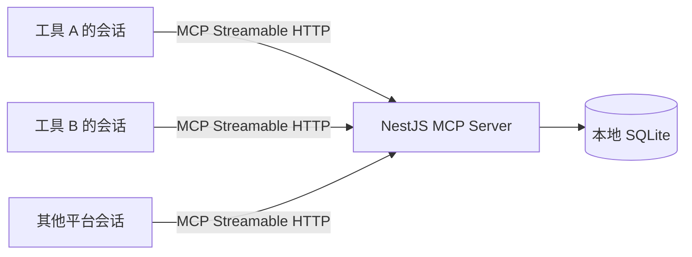

# Chatgroup MCP Server 整体设计

版本：MVP v1  
状态：设计基线，尚未实现  
日期：2026-11-13

## 1. 目标与定位

构建一个通用的会话通信与协作平台，技术栈为 TypeScript、NestJS 和 SQLite。

不同工具、不同平台上的 Agent 会话可以加入同一个聊天组，声明自己的角色与能力，交换消息、引用回复，并通过 board 维护共享进展与成果。例如：WSL 中的会话修改代码，Windows 中的会话控制浏览器并反馈验证结果。

平台不依赖 Codex、Claude Code 等产品的内部会话 ID 或消息 ID。所有参与者标识和跨客户端消息标识均由服务端分配。

### 1.1 职责边界

服务端负责：

- 固定 Token 认证。
- 聊天组和组内参与者管理。
- 消息持久化、排序、回复关联和分页查询。
- 按参与者保存读取进度。
- Board 存储和并发版本检查。

Agent 主动负责：

- 加入组、自我声明、保存和恢复参与者标识。
- 提问、回复、发送通知、主动拉取和确认接收。
- 执行业务任务、更新进展和成果。
- 理解消息并决定后续行动。

MVP 不提供主动唤醒、任务调度、在线状态、心跳、自动总结、附件上传、私信、成员级权限或客户端发送幂等键。

## 2. 总体架构



- 单服务进程运行，所有客户端连接同一个可访问地址。
- MCP 使用官方 TypeScript SDK 接入 NestJS，业务逻辑独立于协议适配层。
- 实现时固定 SDK 和 MCP 协议版本，并验证目标客户端兼容性。
- SQLite 数据文件存储在服务端本地磁盘，不通过网络文件共享供客户端直接访问。
- 客户端自行配置服务地址；跨 Windows / WSL 的网络可达性由部署环境保证。
- 第一版只提供普通主动拉取，不提供长轮询。

## 3. 认证与身份

### 3.1 服务认证

所有 MCP 请求通过 HTTP 请求头认证：

```http
Authorization: Bearer <configured-token>
```

Token 通过环境配置提供，不写入源码、消息或日志。所有持有 Token 的调用方属于同一个可信范围，可以创建、加入、关闭、销毁组，并修改共享 board。

不设置加入码、参与者凭证、组所有者或成员级授权。非本机网络部署应通过 HTTPS 传输 Token。

### 3.2 组内参与者

加入时提供展示名称和自由文本声明，服务端返回 `participant_id`：

```json
{
  "participant_id": "p_7k2",
  "group_id": "grp_abc",
  "display_name": "桌面浏览器验证",
  "declaration": "可以执行浏览器验证并提供截图链接。"
}
```

- `participant_id` 是通信标识，不是安全凭证，不绑定 HTTP 连接。
- 后续成员操作显式传入 `group_id` 和 `participant_id`。
- 服务端检查参与者属于该组，但不验证调用者是否拥有该身份。
- 名称允许重复，不用于寻址；@ 必须使用参与者 ID。
- 每次加入创建新身份，不按名称自动合并。
- 重连时可继续使用原 ID；丢失后可查询成员列表选择恢复，或重新加入。
- 已退出身份保留用于历史引用，但不能继续操作；重新参与需再次加入。
- 同一个 ID 只代表一个逻辑会话。并发会话复用 ID 会共享读取进度。
- 同一会话参加不同组时，各组身份独立。

## 4. 聊天组

组字段：`group_id`、`name`、`description`、`status`、`created_at`、`closed_at`。

生命周期：

```text
active → closed → 物理删除
```

- active：允许加入、发送消息、维护声明、修改 board。
- closed：禁止加入和内容写入，允许读取、查询及确认接收；不支持重新打开。
- 删除：active 或 closed 组均可销毁，删除全部关联数据，后续请求返回 `GROUP_NOT_FOUND`。
- 关闭时追加系统消息，便于成员下一次读取时获知。
- 不自动过期或清理业务数据。

## 5. 消息与系统事件

### 5.1 消息结构

所有组消息共用一条有序消息流：

```json
{
  "message_id": "msg_102",
  "group_id": "grp_abc",
  "seq": 102,
  "type": "message",
  "sender_id": "p_desktop",
  "text": "验证完成，登录正常。",
  "mentions": ["p_wsl"],
  "reply_to_message_id": "msg_101",
  "reply_to_sender_id": "p_wsl",
  "thread_root_message_id": "msg_101",
  "created_at": "2026-11-13T08:00:00Z"
}
```

- `message_id`：服务端生成的全局唯一 ID，数据库保证唯一。
- `seq`：组内单调递增序号，用于排序、游标和读取确认，不用时间戳代替。
- 普通消息统一使用 `message.send`，不区分提问、结果或通知接口。
- `mentions` 仅影响关联展示；所有组消息均对组内读取者可见。
- 消息不可修改，不支持单条删除。
- 附件使用正文中的可访问链接，不上传文件，不假定本地路径能跨平台访问。

### 5.2 回复关系

调用方发送回复时填写 `reply_to_message_id`。服务端校验目标是同组普通消息，并计算：

- `reply_to_sender_id`：目标消息的发送者。
- `thread_root_message_id`：目标所属讨论的根消息；未回复任何消息时为自身 ID。

读取时可返回原消息的简短预览，并根据当前参与者计算 `is_reply_to_me` 和 `is_mentioned`。这些是响应中的派生字段，不作为固定消息属性存储。

直接回复查询只匹配 `reply_to_message_id`；讨论查询按 `thread_root_message_id` 返回整个讨论，包含根消息。

### 5.3 系统消息

以下变化进入同一消息流：

- `participant.joined`
- `participant.updated`
- `participant.left`
- `group.closed`

系统消息的 `sender_id` 为空，`actor_participant_id` 可记录相关参与者，`payload` 保存变化时的声明等快照。普通发送接口不能伪造系统消息类型。

Board 修改不自动生成消息。需要他人关注时，由 Agent 另行发送通知。

### 5.4 发送可靠性边界

MVP 不要求 Agent 生成 `client_message_id` 或 `idempotency_key`。每次成功发送创建一条新消息。

如果写入成功但响应丢失，再次发送可能产生重复消息。服务端不按正文去重，因为相同正文可能是有意重复发送。该限制不影响统一消息 ID 和回复关联。

## 6. 主动读取和确认

### 6.1 未读定义

未读表示该参与者尚未确认接收的消息，不代表未处理或未完成。

每个参与者保存 `last_read_seq`。`message.read` 从该位置之后扫描连续消息范围，返回其他参与者的普通消息和全部系统消息，跳过自身普通消息。

不在该接口提供 @、回复对象等筛选，避免推进游标时跳过未返回的他人消息。

### 6.2 Read / Ack

```text
message.read(group_id, participant_id, limit)
  → messages, read_receipt, has_more

message.ack(group_id, participant_id, read_receipt)
  → last_read_seq
```

- read 不推进读取位置。
- 服务端生成随机回执，绑定组、参与者、起始位置和本页扫描结束位置。
- ack 校验绑定信息，并将读取位置更新为原值与回执结束位置的较大值。
- 重复 ack 安全；旧回执不能让进度倒退。
- 未确认时再次读取可能重复返回消息，按 `message_id` 识别即可。
- 一次最多扫描 `limit` 条流记录，因此跳过自身消息后，返回数量可能少于 limit，甚至为空。
- 只要扫描位置前进，即使返回消息为空，也返回可确认的回执。
- 没有任何新记录时返回空数组、空回执和 `has_more=false`。
- `has_more` 表示本页扫描位置之后仍存在消息记录，Agent 确认当前页后继续读取。
- 回执持久化，服务重启后仍可确认；MVP 不自动过期，随组销毁删除。

读取和确认实现至少一次接收语义，不提供业务处理恰好一次保证。

### 6.3 加入时的读取位置

加入事务中读取当前组序号 N，将新参与者的 `last_read_seq` 设为 N，再追加加入系统消息。加入响应返回自身 ID、当前成员快照和组说明。

默认不把加入前历史当作未读；可通过历史接口主动查询。事务保证加入与消息写入并发时不漏掉加入后的消息。

### 6.4 历史与回复查询

以下查询均不改变读取进度：

- `message.get`：完整读取一条消息。
- `message.list`：按 `after_seq` 顺序分页读取组历史，包含自身消息。
- `message.replies`：查询某条普通消息的直接回复。
- `message.thread`：查询一条普通消息所在的整个讨论。

分页响应包含 `next_seq` 和 `has_more`；所有列表按 seq 升序返回。

## 7. Board

Board 是共享协作状态，不是任务调度系统。适合记录进展、成果、阻塞、环境信息和共同约定，服务端不解释业务内容。

```json
{
  "key": "progress/p_desktop",
  "value": {
    "summary": "验证完成，发现重新登录问题",
    "tested_revision": "abc123",
    "related_message_id": "msg_108"
  },
  "version": 3,
  "updated_by": "p_desktop",
  "updated_at": "2026-11-13T08:00:00Z"
}
```

- 所有活跃成员可以修改任何条目。
- value 支持 JSON；键名由参与方协商，不预设业务 schema。
- `board.list/get` 返回最新状态，不维护已读状态。
- 创建使用 `expected_version=0`，要求键从未存在。
- 修改、删除必须提供当前版本；不匹配返回 `VERSION_CONFLICT`，不覆盖数据。
- 删除保留内部墓碑和递增版本，避免删除后重建导致旧版本误匹配。
- list 默认隐藏墓碑；get 已删除条目返回 `BOARD_ENTRY_DELETED` 和当前版本。
- 重建已删除键时必须携带墓碑版本，重建后继续递增版本。
- 更新和发送消息是两个独立操作，不保证跨调用原子性。

“实时更新”表示写入后后续读取立即可见；其他 Agent 何时获知取决于其读取频率。

## 8. MCP 工具契约

成员操作统一携带 `group_id` 和 `participant_id`，服务端检查组内成员存在且未退出。组管理接口只需固定 Token。

| 工具 | 主要输入 | 主要输出 |
| --- | --- | --- |
| `group.create` | name, description | group |
| `group.list` | cursor?, limit? | groups, next_cursor |
| `group.get` | group_id | group, participants（含退出状态） |
| `group.join` | group_id, display_name, declaration | self, group, participants |
| `group.close` | group_id | group |
| `group.delete` | group_id | deleted |
| `participant.update` | 成员参数, display_name?, declaration? | participant |
| `participant.leave` | 成员参数 | participant |
| `message.send` | 成员参数, text, mentions?, reply_to_message_id? | message |
| `message.read` | 成员参数, limit? | messages, read_receipt, has_more |
| `message.ack` | 成员参数, read_receipt | last_read_seq |
| `message.get` | 成员参数, message_id | message |
| `message.list` | 成员参数, after_seq?, limit? | messages, next_seq, has_more |
| `message.replies` | 成员参数, message_id, after_seq?, limit? | messages, next_seq, has_more |
| `message.thread` | 成员参数, message_id, after_seq?, limit? | messages, next_seq, has_more |
| `board.list` | 成员参数, cursor?, limit? | entries, next_cursor |
| `board.get` | 成员参数, key | entry |
| `board.put` | 成员参数, key, value, expected_version | entry |
| `board.delete` | 成员参数, key, expected_version | key, version, deleted |

创建组不会自动加入，保持创建和加入两个动作语义明确。关闭操作重复调用不重复追加系统消息。

## 9. 数据模型

| 表 | 核心字段与约束 |
| --- | --- |
| groups | id 主键、name、description、status、last_seq、created_at、closed_at |
| participants | id 主键、group_id、display_name、declaration、last_read_seq、joined_at、left_at |
| messages | id 主键、group_id、seq、type、sender_id、actor_participant_id、text、payload_json、reply_to_message_id、thread_root_message_id、created_at；UNIQUE(group_id, seq) |
| message_mentions | message_id、participant_id；联合主键 |
| read_receipts | id 主键、group_id、participant_id、from_seq、through_seq、created_at |
| board_entries | group_id、key 联合主键、value_json、version、updated_by、updated_at、deleted_at |

主要索引：

- messages(group_id, seq)
- messages(group_id, reply_to_message_id, seq)
- messages(group_id, thread_root_message_id, seq)
- participants(group_id)
- read_receipts(group_id, participant_id)

SQLite 开启外键、WAL 和合理的 busy timeout。数据库访问采用参数化语句和显式迁移。

关键事务：

- 分配组内 seq 与插入消息必须原子完成。
- 加入、更新声明、退出、关闭与对应系统消息原子完成。
- 读取范围和回执创建使用一致快照。
- Board 使用带版本条件的 UPDATE 检测并发冲突。
- 写入时在事务内检查组状态，避免关闭与写入竞态。
- 销毁组在事务内清理全部关联记录。

## 10. NestJS 模块

```text
src/
  auth/           固定 Token 认证
  mcp/            SDK 接入、工具注册、输入输出映射
  groups/         聊天组和参与者
  messages/       消息、回复查询、读取回执
  board/          共享条目、版本检查
  database/       SQLite 连接、迁移、事务
  common/         ID、错误码、配置、公共校验
```

MCP 层只做协议适配与参数校验，业务规则放入 NestJS service，数据访问封装在 repository 中。不在 MVP 引入消息队列或跨实例事件系统。

## 11. 限制与错误

建议初始限制均可配置：默认分页 50 条、上限 100 条；消息正文最多 32 KiB UTF-8；单个 board JSON 最多 64 KiB UTF-8；名称最多 128 字符；声明和组说明各最多 8 KiB；board key 最多 256 字符。

参数校验拒绝非法分页、超限内容、跨组回复、跨组 @ 和系统消息伪造。@ 对象必须是当前活跃成员；允许回复已退出成员留下的历史消息。

业务错误返回稳定 code、可读 message 和必要 details：

```text
GROUP_NOT_FOUND / GROUP_CLOSED
PARTICIPANT_NOT_FOUND / PARTICIPANT_LEFT
MESSAGE_NOT_FOUND / INVALID_REPLY_TARGET
INVALID_MENTION / INVALID_READ_RECEIPT
BOARD_ENTRY_NOT_FOUND / BOARD_ENTRY_DELETED / VERSION_CONFLICT
INVALID_ARGUMENT / PAYLOAD_TOO_LARGE / STORAGE_BUSY
```

认证失败在 HTTP 层返回 401；工具业务错误采用 SDK 支持的结构化错误结果，并明确标记调用失败。

## 12. 典型协作流程

1. WSL 会话创建并加入组，获得参与者 ID，写入环境 board。
2. 桌面会话查找并加入组，声明浏览器验证能力，阅读成员和 board。
3. WSL 会话完成修改，发送 @ 桌面的验证请求，保存返回的消息 ID。
4. 桌面会话主动 read，成功接收后 ack，执行验证。
5. 桌面会话更新自己的进展条目，发送结果并引用原请求消息 ID。
6. WSL 会话主动 read 或查询原请求的 replies，获取结果并继续处理。
7. 参与方按约定更新整体进展；协作结束后关闭组，需要清理时销毁。

建议 Agent 在开始工作、阶段结束和等待协作时主动读取。消息读取确认不应等待实际任务完成。验证结果应注明实际验证的版本，防止把不同代码版本的结果混淆。

## 13. 实现验收重点

- 两种客户端能够加入同组，并使用统一消息 ID 相互回复。
- 重连和服务重启后仍能使用原参与者 ID、读取进度与回执。
- read 响应丢失不会导致消息被自动标记已读。
- 重复 ack、旧回执以及错误参与者使用回执均符合约定。
- 自身消息、空页和分页边界不会阻塞读取进度或跳过他人消息。
- 并发发送的组内 seq 不重复；加入边界不漏消息。
- 两个参与者同时更新 board，只有版本匹配的写入成功。
- Board 删除和重建不会使旧版本重新生效。
- 组关闭与写入并发时不出现关闭后成功写入的竞态。
- 组销毁后不存在可读取的孤立消息、board 或回执。

后续扩展仅在需要时考虑：长轮询、可靠客户端的发送幂等键、附件存储、多实例部署和更细粒度权限。
